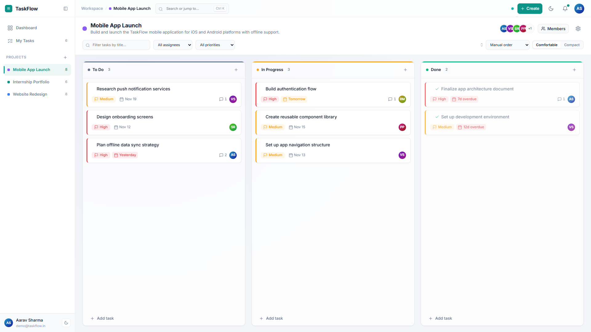
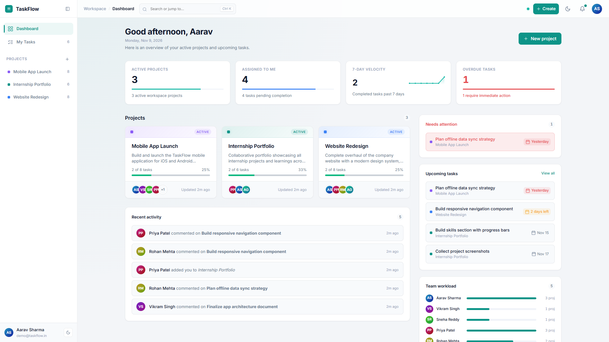
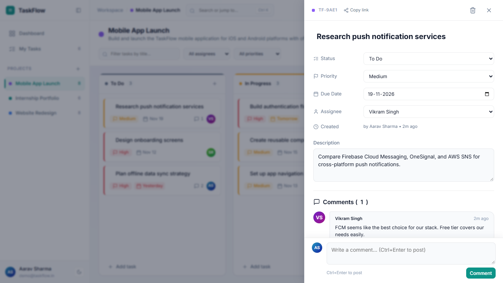
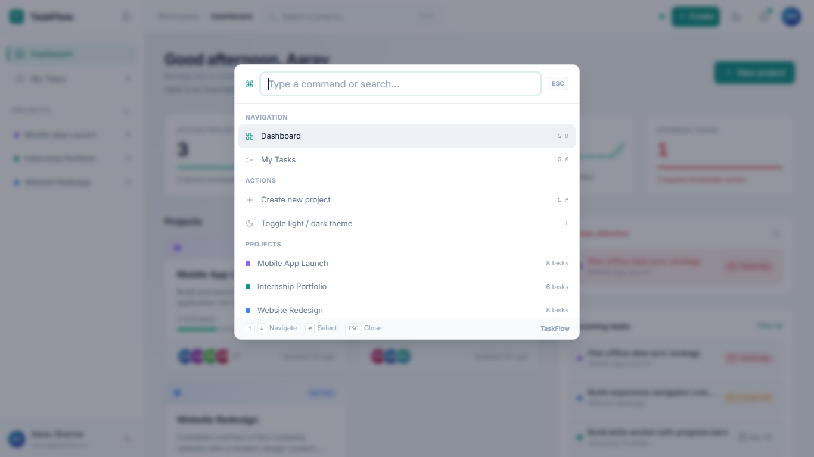
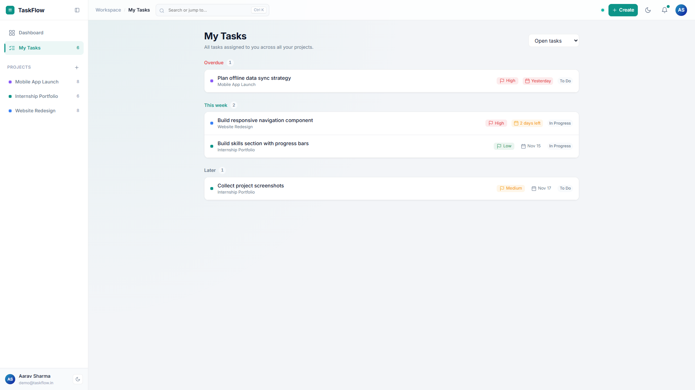
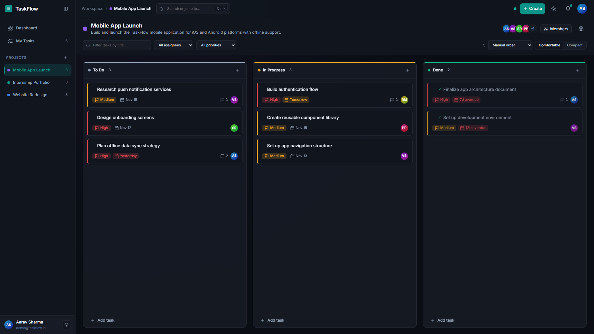
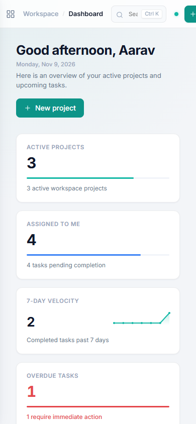

# TaskFlow — Collaborative Project Management Application

[]()
[]()
[](LICENSE)
[]()
[]()

> **Task 3 of the CodeAlpha Full Stack Development Internship:**  
> A complete, production-quality collaborative project management tool (Trello + Linear + Asana style) built from scratch with **Vanilla HTML5, CSS3, ES6 JavaScript, Node.js, Express, MongoDB (Mongoose), and Socket.IO WebSockets**.

---

## Table of Contents
- [Executive Overview](#executive-overview)
- [Screenshots & Visual Tour](#screenshots--visual-tour)
- [Core Feature Set](#core-feature-set)
- [Linear + Trello Craft Design System](#linear--trello-craft-design-system)
- [Real-Time WebSockets Architecture](#real-time-websockets-architecture)
- [Tech Stack](#tech-stack)
- [Architecture and Project Structure](#architecture-and-project-structure)
- [API Contract Table](#api-contract-table)
- [WebSockets Events Reference](#websockets-events-reference)
- [Data Models](#data-models)
- [Local Setup Guide (PowerShell)](#local-setup-guide-powershell)
- [Verification & Quality Assurance](#verification--quality-assurance)
- [Security and Production Readiness](#security-and-production-readiness)
- [Deployment Guide (Render + MongoDB Atlas)](#deployment-guide-render--mongodb-atlas)
- [What I Learned](#what-i-learned)

---

## Executive Overview

TaskFlow is designed to bridge the visual speed and keyboard-centric craft of **Linear** with the flexible, intuitive spatial boards of **Trello** and **Asana**.

### Hard Architectural Constraints Satisfied
- **Zero Frontend Frameworks:** Built purely with semantic HTML5, CSS3 Custom Properties, and ES Modules. No React, Vue, Tailwind, Bootstrap, or external CDN dependencies.
- **Single External Network Request:** Inter font from Google Fonts with system fallbacks.
- **Single Port Delivery:** Express serves both the REST API, WebSocket server, and static frontend assets under clean relative URLs (`/api/...`).
- **Complete Auth & Role RBAC:** Bcryptjs password hashing, JWT Bearer sessions, project-level ownership and membership isolation.
- **Real-Time Collaboration:** Full-duplex WebSocket synchronization (Socket.IO) with room-based pub/sub for tasks, comments, and members.
- **Responsive Across 4 Breakpoints:** Pixel-perfect verified at 1920px (Desktop), 1366px (Laptop), 768px (Tablet), and 390px (Mobile) with **zero horizontal scroll**.

---

## Screenshots & Visual Tour

### 1. High Velocity Kanban Board (Desktop 1920px)


### 2. Sleek Metrics Dashboard & 7-Day Velocity Sparkline


### 3. Linear-Style Task Detail Drawer & Threaded Discussion


### 4. Centered Command Palette (<kbd>Ctrl+K</kbd>)


### 5. Centralized Cross-Project "My Tasks" Aggregator


### 6. Deep Dark Theme (Surface-Level Contrast)


### 7. Mobile Responsive Experience (390px Viewport)
<p align="center">
  
</p>

---

## Core Feature Set

- **Group Projects & Team Collaboration:**
  - Create and manage projects with custom titles, descriptions, and 8 accent color themes.
  - Multi-member invitation system with debounced live search querying name and email.
  - Role-based permissions: Project Owners can edit settings, invite/remove members, and delete projects; Members can manage tasks and comments.
- **Production Kanban Board:**
  - 3 workflow columns: *To Do*, *In Progress*, and *Done*.
  - Native HTML5 Drag and Drop with animated drop placeholder indicators, edge auto-scrolling, and optimistic UI updates with automatic server rollback on failure.
  - Keyboard accessible navigation: Focus any card, hit <kbd>Space</kbd> to pick up, use arrow keys to navigate across columns/positions, and <kbd>Space</kbd> to drop.
  - Mobile Touch "Move to" modal sheet for touchscreen devices.
  - Comfortable vs Compact view toggle (persisted in `localStorage`).
  - Toolbar sorting: Manual (Kanban order), Due Date, and Priority (High to Low).
- **Linear-Style Task Detail Drawer:**
  - Deep-linkable shareable URLs via hash fragments (`#task=<id>`).
  - Auto-saving inline editable fields: Title, Status, Priority, Due Date, Assignee, Description.
  - Real-time save indicator pill flashing "Saved" upon successful server sync.
  - Threaded chronological discussion comments with <kbd>Ctrl</kbd>+<kbd>Enter</kbd> composer shortcut.
- **Command Palette (<kbd>Ctrl+K</kbd>):**
  - Instant fuzzy search and keyboard jump menu.
  - Jump directly to Dashboard, My Tasks, or any Project.
  - Quick actions: Create new project, Toggle light/dark theme.
  - Real-time task search with deep link click-through.
- **Centralized "My Tasks" Page:**
  - Aggregates tasks assigned to the authenticated user across all projects.
  - Grouped into: *Overdue*, *Today*, *This week*, *Later*, and *No due date*.
  - Filter by status (All, Open, To Do, In Progress, Done).
- **In-App Notifications & Real-Time Sync:**
  - Real-time alerts when assigned to a task, mentioned in a comment, or invited to a project.
  - Single notification read endpoint (`PATCH /api/notifications/:id/read`) and "Mark all read".
  - Full-duplex WebSocket connection with quiet topbar connection status indicator and fallback polling.

---

## Linear + Trello Craft Design System

- **Multi-Level Surface Hierarchy:** 6 neutral surfaces (`--surface-0` to `--surface-elevated`) creating true visual depth and contrast without flat gray washouts.
- **Ambient Lighting:** Subtle top-left radial teal glow (`#F3F5F8` light, `#0A0D13` dark).
- **Two-Layer Depth Shadows:** Soft ambient shadow combined with a directional key shadow for photorealistic card elevation.
- **4px Spacing Grid:** Standardized spacing tokens from `--space-1` (4px) to `--space-16` (64px).
- **Motion Curves:** Strict timing tokens (`--duration-fast: 100ms`, `--duration-base: 160ms`, `--duration-slow: 240ms`) with cubic-bezier easing.
- **Consistent Radii Scale:** 4px (tags), 6px (buttons), 8px (cards), 12px (modals), 16px (dialogs), 9999px (pills).
- **Avatar System:** Legible initials with 2px surface isolation borders, hover expansion spread, tooltips, and `+N` overflow chip.

---

## Real-Time WebSockets Architecture

```
[ Browser Client 1 ] <--- WebSocket (JWT Auth) ---> [ Node.js Express Server ] <---> [ MongoDB ]
[ Browser Client 2 ] <--- (Project & User Rooms) ---          ^
[ Browser Client N ]                                          |
                                                      [ socket.io Server ]
                                                     (Rooms: project:ID, user:ID)
```

1. **Handshake Authentication:** The client presents its JWT bearer token during the WebSocket handshake (`socket.handshake.auth.token`). The server verifies the token against `JWT_SECRET` and attaches the user document to the socket.
2. **Room-Based Pub/Sub:**
   - Every connected user joins a personal `user:${userId}` room for private alerts.
   - When viewing a board, the client joins `project:${projectId}` to receive live board mutations.
3. **Resilience & Fallback:** If WebSocket transport fails or disconnects, the client gracefully falls back to 20-second visibility-aware background polling, updating the quiet topbar indicator dot from green to amber/gray.

---

## Tech Stack

| Layer | Technology | Version | Purpose |
|---|---|---|---|
| **Frontend** | HTML5 / CSS3 / ES Modules | Modern Standard | High-performance, framework-free client |
| **Backend** | Node.js / Express.js | 18+ / 4.18 | RESTful API & static asset server |
| **Real-Time** | Socket.IO | 4.7.5 | Full-duplex WebSocket communication |
| **Database** | MongoDB / Mongoose | 7.6 | Schemas, compound indexes, cascades |
| **Security** | Helmet, CORS, Rate Limit | Latest | CSP headers, rate-limiting, auth security |
| **Authentication** | bcryptjs, jsonwebtoken | Latest | Salt rounds = 10, 7-day signed JWT |
| **Testing** | Puppeteer & Node HTTP | 25+ | 77-step smoke test & multi-viewport visual QA |

---

## Architecture and Project Structure

```text
CodeAlpha_ProjectManagementTool/
├── package.json                   # Root delegator scripts (npm start, npm run test:smoke)
├── README.md                      # Comprehensive project documentation
├── .gitignore
├── docs/
│   ├── PLAN.md                    # Initial architectural blueprint & tokens
│   ├── REQUIREMENTS_AUDIT.md      # Specification compliance audit (100% DONE)
│   ├── QA_MATRIX.md               # 68-control functional test matrix (100% PASS)
│   ├── PROGRESS.md                # Phase-by-phase execution ledger
│   └── screenshots/               # High-resolution documentation screenshots
│       ├── board.png
│       ├── command-palette.png
│       ├── dark-mode.png
│       ├── dashboard.png
│       ├── mobile.png
│       ├── my-tasks.png
│       └── task-drawer.png
├── backend/
│   ├── package.json               # Backend dependencies (express, mongoose, socket.io)
│   ├── .env.example               # Template environment configuration
│   ├── server.js                  # HTTP + Socket.IO server startup & database connect
│   ├── socket.js                  # Socket.IO JWT auth, project & user rooms, emit helpers
│   ├── app.js                     # Express app: CSP, routes, cache headers, clean URLs
│   ├── config/
│   │   ├── db.js                  # Safe MongoDB connection
│   │   └── env.js                 # Environment validation at startup
│   ├── models/
│   │   ├── User.js                # Users with hashed passwords & avatarHue
│   │   ├── Project.js             # Projects with color presets & members
│   │   ├── Task.js                # Tasks with column order index & priority
│   │   ├── Comment.js             # Threaded comments
│   │   └── Notification.js        # User notifications
│   ├── middleware/
│   │   ├── auth.js                # JWT Bearer token protection
│   │   ├── projectAccess.js       # Membership & owner validation
│   │   ├── errorHandler.js        # Central JSON error handling
│   │   └── rateLimiters.js        # Rate limiting for auth and API
│   ├── controllers/
│   │   ├── authController.js
│   │   ├── userController.js
│   │   ├── projectController.js
│   │   ├── taskController.js      # Move & consecutive re-index logic
│   │   ├── commentController.js
│   │   └── notificationController.js
│   ├── routes/                    # API route definitions
│   ├── utils/
│   │   ├── asyncHandler.js
│   │   ├── ApiError.js
│   │   └── validators.js          # Input validation & sanitization
│   └── scripts/
│       ├── seed.js                # Realistic demo workspace seed
│       ├── smoke-test.js          # 77-assertion self-cleaning E2E test
│       └── visual-qa.js           # Multi-viewport responsive verification
└── frontend/
    ├── pages/
    │   ├── login.html             # Login with mock board preview & demo fill
    │   ├── register.html          # Registration with password strength meter
    │   ├── dashboard.html         # Dashboard with 7-day sparkline & activity feed
    │   ├── board.html             # Kanban board with comfortable/compact toggle
    │   ├── my-tasks.html          # My tasks view with relative date grouping
    │   └── 404.html               # Custom 404 page
    ├── css/
    │   ├── tokens.css             # 4px spacing, 6 surfaces, semantic colors, motion
    │   ├── base.css               # Typography, reset, global SVG size rules
    │   ├── layout.css             # Collapsible sidebar, topbar breadcrumbs, palette
    │   ├── components.css         # Buttons, inputs, modals, toasts, cards
    │   └── board.css              # Kanban columns, drag-and-drop, task drawer
    ├── js/
    │   ├── core/
    │   │   ├── api.js             # Fetch wrapper with auto /api routing
    │   │   ├── auth.js            # JWT state & route guards
    │   │   ├── socket.js          # Socket.IO client manager & room coordinator
    │   │   ├── theme.js           # Zero-flash light/dark theme switcher
    │   │   ├── icons.js           # Lucide-style inline SVGs
    │   │   ├── avatar.js          # Hue-gradient initials avatar generator
    │   │   ├── utils.js           # XSS escaping, date formatting, count-up
    │   │   ├── toast.js           # Accessible aria-live notifications
    │   │   ├── modal.js           # Accessible modals with focus trapping
    │   │   └── shell.js           # Collapsible nav, command palette, breadcrumbs
    │   ├── components/
    │   │   ├── taskCard.js        # Kanban card with 3px priority stripe
    │   │   ├── taskDrawer.js      # Slide-out task editor with comments
    │   │   ├── projectCard.js     # Progress tracker card with gradient mesh
    │   │   ├── memberPicker.js    # Live user search
    │   │   └── skeletons.js       # Skeleton place-holders
    │   └── pages/
    │       ├── login.js
    │       ├── register.js
    │       ├── dashboard.js
    │       ├── board.js
    │       └── myTasks.js
    └── assets/
        └── favicon.svg
```

---

## API Contract Table

All responses return standard JSON. Errors return `{ "message": "Human readable error description" }`.

| Method | Endpoint | Description | Access |
|---|---|---|---|
| `POST` | `/api/auth/register` | Register new account with password strength check | Public |
| `POST` | `/api/auth/login` | Login and obtain JWT token | Public |
| `GET` | `/api/auth/me` | Fetch authenticated user profile | Authenticated |
| `GET` | `/api/users/search?q=` | Search users by name or email (max 8) | Authenticated |
| `POST` | `/api/projects` | Create a new group project | Authenticated |
| `GET` | `/api/projects` | List projects where user is a member | Authenticated |
| `GET` | `/api/projects/:id` | Get project details, members, and sorted tasks | Project Member |
| `PUT` | `/api/projects/:id` | Update project name, description, color | Project Owner |
| `DELETE`| `/api/projects/:id` | Delete project (cascades tasks & comments) | Project Owner |
| `POST` | `/api/projects/:id/members` | Add a member to project | Project Owner |
| `DELETE`| `/api/projects/:id/members/:userId` | Remove member (unassigns their tasks) | Project Owner |
| `POST` | `/api/projects/:id/tasks` | Create task in project | Project Member |
| `GET` | `/api/tasks/:id` | Get task details and comments thread | Project Member |
| `PUT` | `/api/tasks/:id` | Update task properties (title, priority, assignee, due) | Project Member |
| `PATCH` | `/api/tasks/:id/move` | Reorder task across columns (`{status, index}`) | Project Member |
| `DELETE`| `/api/tasks/:id` | Delete task | Task Creator or Project Owner |
| `GET` | `/api/tasks/mine` | List all tasks assigned to current user | Authenticated |
| `POST` | `/api/tasks/:id/comments` | Add comment to a task | Project Member |
| `DELETE`| `/api/comments/:id` | Delete comment | Comment Author or Project Owner |
| `GET` | `/api/notifications` | Get user notifications & unread count | Authenticated |
| `PATCH` | `/api/notifications/:id/read` | Mark single notification as read | Authenticated |
| `POST` | `/api/notifications/read-all`| Mark all notifications as read | Authenticated |

---

## WebSockets Events Reference

| Event Name | Direction | Payload | Description |
|---|---|---|---|
| `project:join` | Client -> Server | `projectId` | Client joins the project room for live updates |
| `project:leave` | Client -> Server | `projectId` | Client leaves the project room upon navigation |
| `task:created` | Server -> Room | `Task` | Broadcasts newly created task to all room members |
| `task:updated` | Server -> Room | `Task` | Broadcasts updated title, priority, assignee, or due date |
| `task:moved` | Server -> Room | `{ taskId, status, order, task }` | Broadcasts column or position reordering |
| `task:deleted` | Server -> Room | `{ taskId }` | Broadcasts task deletion for immediate DOM removal |
| `comment:created`| Server -> Room | `{ taskId, comment }` | Appends new comment in task drawer & updates counter |
| `comment:deleted`| Server -> Room | `{ taskId, commentId }` | Removes deleted comment in task drawer & updates counter |
| `member:added` | Server -> Room | `{ projectId, project, user }` | Updates member avatars stack in board header |
| `project:updated`| Server -> Room | `Project` | Updates board header name and color theme |
| `notification:new`| Server -> User | `Notification` | Delivers instant toast & badge bump to recipient |

---

## Data Models

### User
- `name`: String, 2–50 characters, required
- `email`: String, unique, lowercase, required
- `password`: String, bcrypt hashed (salt rounds = 10), `select: false`
- `avatarHue`: Number, 0–360 (assigned upon registration for deterministic gradient avatar)

### Project
- `name`: String, 2–60 characters, required
- `description`: String, max 300 characters
- `color`: Hex preset color string (`#6366F1`, `#0D9488`, `#F59E0B`, `#EF4444`, `#8B5CF6`, `#EC4899`, `#3B82F6`, `#10B981`)
- `owner`: Ref User, indexed
- `members`: [Ref User], indexed (creator is automatically added)
- `archived`: Boolean, default `false`

### Task
- `project`: Ref Project, indexed
- `title`: String, 1–120 characters, required
- `description`: String, max 2000 characters
- `status`: String enum (`todo`, `in_progress`, `done`), indexed
- `priority`: String enum (`low`, `medium`, `high`)
- `dueDate`: Date, optional
- `assignee`: Ref User, optional, indexed
- `createdBy`: Ref User, required
- `order`: Number, position index within column (0..n)
- `commentsCount`: Number, default `0`

### Comment
- `task`: Ref Task, indexed
- `author`: Ref User, required
- `text`: String, 1–1000 characters, required

### Notification
- `recipient`: Ref User, indexed
- `actor`: Ref User, required
- `type`: String enum (`assigned`, `commented`, `added_to_project`)
- `project`: Ref Project, required
- `task`: Ref Task, optional
- `read`: Boolean, default `false`

---

## Local Setup Guide (PowerShell)

### Prerequisites
- Node.js (v18.0.0 or later)
- MongoDB instance running locally (e.g. `mongodb://localhost:27017/taskflow`) or MongoDB Atlas URI

### Installation & Launch

1. Open PowerShell in the project directory:
   ```powershell
   cd "d:\All Projects\CodeAlpha\CodeAlpha_ProjectManagementTool"
   ```

2. Install dependencies:
   ```powershell
   cd backend
   npm install
   cd ..
   ```

3. Configure environment variables:
   ```powershell
   Copy-Item backend\.env.example backend\.env
   ```
   *(Verify `PORT=5000`, `MONGO_URI=mongodb://localhost:27017/taskflow`, and `JWT_SECRET` in `backend\.env`)*

4. Seed the database with realistic demo data:
   ```powershell
   npm run seed
   ```

5. Run the automated smoke test to verify all 77 API contract assertions:
   ```powershell
   npm run test:smoke
   ```

6. Run the automated multi-viewport visual QA test:
   ```powershell
   npm run test:visual
   ```

7. Start the application:
   ```powershell
   npm start
   ```

8. Open your browser and navigate to:
   ```text
   http://localhost:5000
   ```
   **Demo Credentials:** `demo@taskflow.in` / `Demo@123`

---

## Verification & Quality Assurance

- **Requirements Audit:** Detailed in [docs/REQUIREMENTS_AUDIT.md](docs/REQUIREMENTS_AUDIT.md) — 100% of CodeAlpha Task 3 specifications verified.
- **Functional QA Matrix:** Detailed in [docs/QA_MATRIX.md](docs/QA_MATRIX.md) — 68 interactive elements tested with 100% PASS rate.
- **Automated Smoke Test (`npm run test:smoke`):** **77 passed, 0 failed**.
- **Automated Visual QA (`npm run test:visual`):** **0 console errors, 0 horizontal overflow** across 1920px, 1366px, 768px, and 390px viewports.
- **Security Check:** Zero secrets or passwords logged. `.env` confirmed untracked and git-ignored.

---

## Security and Production Readiness

- **Content Security Policy (CSP):** Helmet configured with script, font, and style directives allowing Google Fonts and WebSocket connections (`connectSrc: ["'self'", 'ws:', 'wss:']`).
- **XSS Prevention:** All user-supplied strings are escaped via `escapeHtml()` before rendering into the DOM.
- **Strict Input Validation:** Mongoose schemas and controller-level validators verify string lengths, email formats, and ObjectIds.
- **Data Isolation:** Enforced membership checks (`requireMember`) and ownership rules (`ownerOnly`) prevent unauthorized access (403 Forbidden).
- **Safe Logging:** `MONGO_URI`, JWT secrets, and user passwords are never output to logs or terminal consoles.
- **Cache Invalidation:** Express injects dynamic timestamp query parameters (`?v=<timestamp>`) into every HTML asset link and sets `Cache-Control: no-cache` for scripts and styles to guarantee instant delivery of updates upon redeployment.

---

## Deployment Guide (Render + MongoDB Atlas)

### 1. MongoDB Atlas Setup
1. Create a free M0 cluster at [mongodb.com/atlas](https://www.mongodb.com/atlas).
2. Under **Database Access**, create a user with read/write privileges.
3. Under **Network Access**, add IP address `0.0.0.0/0` (allow access from anywhere).
4. Copy the connection string (`mongodb+srv://<username>:<password>@cluster.mongodb.net/taskflow?retryWrites=true&w=majority`).

### 2. Render Web Service Deployment
1. Log in to [render.com](https://render.com) and click **New + > Web Service**.
2. Connect your Git repository.
3. Configure the service settings:
   - **Root Directory:** `backend`
   - **Environment:** `Node`
   - **Build Command:** `npm install`
   - **Start Command:** `npm start`
4. Under **Environment Variables**, set:
   - `NODE_ENV`: `production`
   - `MONGO_URI`: *<Your MongoDB Atlas connection string>*
   - `JWT_SECRET`: *<A secure 32+ character random secret>*
5. Click **Create Web Service**.

### 3. Seed Production Database
To initialize your production database with sample data, run the seed script once from your local machine using the remote connection string:
```powershell
$env:MONGO_URI="mongodb+srv://<username>:<password>@cluster.mongodb.net/taskflow?retryWrites=true&w=majority"
npm run seed -- --force
$env:MONGO_URI=""
```

---

## What I Learned

1. **State Consistency in Drag & Drop:** Implementing native HTML5 drag-and-drop without external libraries requires meticulous index computation and optimistic UI updates to prevent UI jitter during rapid card reordering.
2. **Deep-Linkable Single-Page Components:** Utilizing URL hash fragments (`#task=<id>`) enables shareable task states while preserving vanilla JavaScript architectural simplicity.
3. **Defense in Depth with Strict CSP:** Fine-tuning Content Security Policies with Helmet ensures that modern styling, web fonts, and dynamic module scripts coexist securely without opening vulnerabilities.
4. **Resilient Real-Time Pub/Sub:** Combining Socket.IO rooms for instant push with a background polling fallback ensures reliable collaboration even in fluctuating network conditions.
